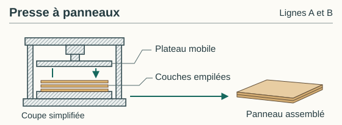
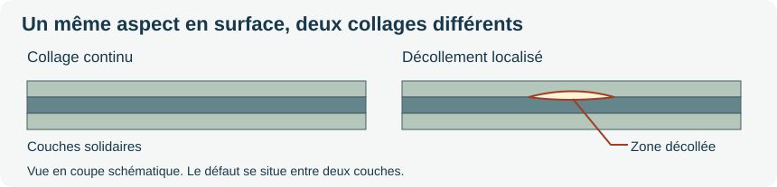
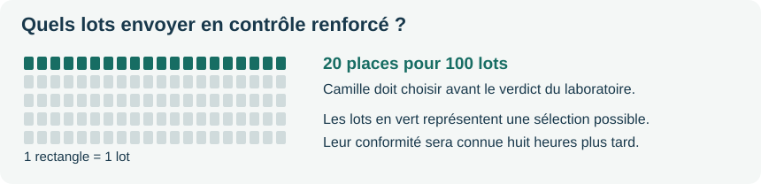

# Machine learning en Python : travaux pratiques MLB

<!-- rumdl-disable-next-line MD033 -->


**Première utilisation ?** [Récupérez le dépôt](#récupérer-le-dépôt-avec-git), puis [préparez votre poste](#préparer-son-poste).

## Votre mission chez Nervure Composites

<!-- rumdl-disable-next-line MD033 -->


<!-- rumdl-disable-next-line MD033 -->


Nervure Composites est une usine fictive qui fabrique des panneaux pour
l’aménagement de véhicules utilitaires. Sur les lignes A et B, plusieurs
couches de matériau sont assemblées sous presse. À la sortie, chaque lot
porte un identifiant. La température, la pression et la durée du cycle
sont déjà enregistrées. Un panneau peut pourtant sembler impeccable alors
que deux couches adhèrent mal.

<!-- rumdl-disable-next-line MD033 -->


Camille, responsable qualité, doit choisir les lots à inspecter en priorité.
Son équipe dispose de 20 créneaux de contrôle renforcé pour 100 lots.
Une fausse alerte occupe un créneau. Un défaut manqué peut obliger un client
à démonter un panneau déjà posé. Le laboratoire rend son verdict huit heures
après la production. Ce résultat permet de vérifier après coup si l’alerte
était justifiée.

<!-- rumdl-disable-next-line MD033 -->


Camille vous confie l’historique synthétique de **720 lots**. Votre première
mission est de déterminer ce que l’équipe pouvait savoir à la sortie de la
presse. Vous construirez ensuite une règle de priorité et la suivrez sur les
nouveaux lots. La décision de libérer un lot reste du ressort de la qualité.

## Parcours des huit TP

Chaque TP correspond à une partie du support MLB. Dans le TP 03, par exemple,
les repères **Atelier 3.1** et **Atelier 3.2** indiquent où commencer et reprendre.
Vous retrouverez les mêmes repères dans le corrigé.

| Chapitre | TP | Travail réalisé |
| --- | --- | --- |
| 1. Introduction au machine learning | **[TP 01. Quelles informations peut-on utiliser pour décider ?](TP01_cadrer_et_explorer.ipynb)** ([corrigé](corrections/TP01_cadrer_et_explorer.ipynb)) | Distinguer les mesures disponibles à la sortie de la presse du verdict connu huit heures plus tard. Rédiger la fiche de cadrage puis appliquer deux arbres avec Spark. |
| 2. Procédures d’évaluation de modèles | **[TP 02. À partir de quel score déclencher une inspection ?](TP02_evaluer_et_decider.ipynb)** ([corrigé](corrections/TP02_evaluer_et_decider.ipynb)) | Choisir un seuil sur les lots de validation en tenant compte du coût des erreurs et des places en inspection. Comparer les modèles sur trois fenêtres chronologiques. |
| 3. Les modèles prédictifs et l’approche fréquentiste | **[TP 03. Peut-on distinguer les lots défectueux à partir des mesures ?](TP03_pca_et_svm.ipynb)** ([corrigé](corrections/TP03_pca_et_svm.ipynb)) | Projeter les mesures avec la PCA, puis comparer les frontières des SVM et d’un réseau de neurones (MLP). Appliquer les SVM à des chiffres manuscrits. |
| 3. Les modèles prédictifs et l’approche fréquentiste | **[TP 04. Pourquoi ce lot a-t-il été signalé ?](TP04_arbres_et_ensembles.ipynb)** ([corrigé](corrections/TP04_arbres_et_ensembles.ipynb)) | Expliquer la décision d’un arbre et comparer ses alertes à celles d’une forêt aléatoire et de XGBoost. Comparer deux stratégies de bandit. |
| 4. Les modèles et apprentissages bayésiens | **[TP 05. Comment une mesure modifie-t-elle la probabilité d’un défaut ?](TP05_bayes_et_gel.ipynb)** ([corrigé](corrections/TP05_bayes_et_gel.ipynb)) | Actualiser un risque avec Bayes, comparer Naive Bayes aux candidats précédents et sauvegarder le modèle local avec son seuil pour le TP 08. Interpréter deux graphes de dépendance et un mélange gaussien. |
| 4. Les modèles et apprentissages bayésiens | **[TP 06. Une vibration forte suffit-elle à faire vérifier la presse ?](TP06_derive_de_ligne.ipynb)** ([corrigé](corrections/TP06_derive_de_ligne.ipynb)) | Suivre l’état caché de la presse à partir de vibrations bruitées. Vérifier quels épisodes déclenchent une alerte et avec quel retard. Estimer une vibration entre deux relevés par processus gaussien. |
| 5. Machine learning en production | **[TP 07. Obtient-on la même décision en batch et en streaming ?](TP07_pipeline_spark.ipynb)** ([corrigé](corrections/TP07_pipeline_spark.ipynb)) | Sauvegarder un pipeline Spark MLlib pour le TP 08 et vérifier que le batch et le streaming produisent les mêmes décisions. |
| 5. Machine learning en production | **[TP 08. Peut-on recommander la mise en service ?](TP08_architecture_surveillance_et_evaluation.ipynb)** ([corrigé](corrections/TP08_architecture_surveillance_et_evaluation.ipynb)) | Recharger les versions des TP 05 et 07, comparer leur coût et leur charge sur le test réservé et recommander une architecture avec des conditions de suspension. Comparer VM locale et service Spark managé. |

Conservez le dossier `artefacts/` créé sur votre poste aux TP 05 et 07. Le TP 08 recharge ces deux versions.
Ouvrez les données de `donnees/tp08/` seulement à l’étape d’évaluation finale.

## Récupérer le dépôt avec Git

Utilisez le compte GitHub auquel l’accès au dépôt privé a été accordé.

```sh
git clone https://github.com/lapeyrade/mlb-tp.git
cd mlb-tp
```

## Préparer son poste

1. Dans VS Code, choisissez **Fichier > Ouvrir le dossier** et ouvrez
   le dossier `mlb-tp` que Git vient de créer.
2. Ouvrez **Terminal > Nouveau terminal**. Tapez `uv --version`.
   Si une version s’affiche, passez directement à l’étape suivante.
   Sinon, sur Windows, lancez `winget install --id=astral-sh.uv -e`.
   Sur macOS ou Linux, lancez `curl -LsSf https://astral.sh/uv/install.sh | sh`.
   Fermez et rouvrez VS Code, puis vérifiez à nouveau avec `uv --version`.
3. Dans le terminal, exécutez les deux lignes suivantes.

```sh
uv sync --locked --extra spark
uv run --no-sync python --version
```

La deuxième commande doit afficher `Python 3.13.18`. uv installe Python
si nécessaire et crée l’environnement dans `.venv`. Prévoyez un accès
Internet pour cette première installation. Sur macOS, si XGBoost signale que
`libomp.dylib` est introuvable, installez OpenMP avec `brew install libomp`
puis redémarrez le noyau du notebook.

Si uv ne trouve pas le projet, vérifiez que `dir` (Windows) ou `ls`
(macOS et Linux) affiche bien `pyproject.toml` dans le terminal.

La manipulation des deux arbres au TP 01 et les TP 07 et 08 utilisent l’option Spark de la commande ci-dessus.
Cette option installe PySpark. Au premier démarrage, le notebook télécharge
un JDK Java 21 complet dans le cache de votre compte.
Sous Windows, conservez le dossier `support/spark` dans le dépôt. Les notebooks
y chargent automatiquement le [pilote de fichiers locaux de GlobalMentor](https://github.com/globalmentor/hadoop-bare-naked-local-fs)
pour écrire et relire le modèle et les checkpoints avec Java 21.
Exécutez les TP 05 et 07 jusqu’au bout avant de lancer le TP 08.
Si une session Spark était ouverte avant la mise à jour du dépôt, cliquez sur
**Redémarrer le noyau**, puis sur **Exécuter tout**.

## Commencer le chapitre 1

Ouvrez le notebook du TP 01 depuis le tableau du parcours.
Dans VS Code, ouvrez la vue **Extensions**, puis installez les extensions
**Python** et **Jupyter** de Microsoft si elles sont absentes.
Dans le notebook, cliquez sur **Sélectionner un noyau** en haut à droite,
puis **Environnements Python** et choisissez le Python du dossier `.venv`.
Exécutez les cellules dans l’ordre avec **Maj + Entrée**.
Chaque corrigé reprend les questions du TP et détaille aussi les réponses aux défis facultatifs.

## Travailler seul dans un notebook

Commencez par le TP 01. Une connaissance des variables, des conditions et
des tableaux Python vous aidera. Vous pouvez découvrir le machine learning
au fil des exercices.

1. Avant de lancer une cellule, lisez la question au-dessus. Sur un graphique,
   repérez ce que représente un point et quelle population est comptée.
2. Quand le code contient une consigne en commentaire, complétez la cellule,
   puis exécutez-la avec **Maj + Entrée**. Pour écrire dans une zone
   **Votre réponse**, double-cliquez dessus. Notez une valeur, son unité
   et la décision qu’elle justifie pour Camille. Enregistrez le notebook.
3. Si une cellule se termine sans rien afficher, regardez sa dernière ligne.
   Une affectation comme `lots = ...` conserve un résultat pour la suite.
   Si Python affiche `NameError`, remontez à la cellule qui définit le nom
   indiqué et exécutez les cellules dans l’ordre depuis cet endroit.
4. Ouvrez le corrigé au même titre de section une fois votre réponse écrite.
   Si vos chiffres diffèrent, comparez d’abord la période, les lots retenus
   et le seuil. Corrigez votre raisonnement avant de passer à la suite.
   Vous pouvez revenir aux défis facultatifs après le parcours principal.
